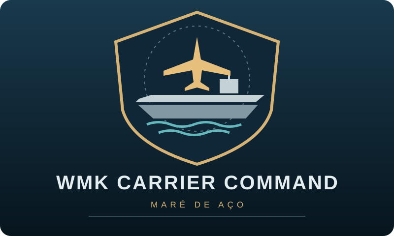

# WMK Carrier Command v0.2.0
Walney Moreira Klein — walneyk@hotmail.com

Abra index.html via Live Server no VS Code ou XAMPP. Internet necessária para Three.js CDN.

Escolha uma operação no porto. W/S velocidade, A/D curva, E/Q altitude, Espaço ataque, R retorno/lançamento. 1/2/3 selecionam armamento no convés. Cada surtida tem duas salvas. Torpedos exigem altitude até 22, bombas a partir de 35 (unidades de jogo). Tab alterna comando e voo (comando inicia retorno); V alterna câmera, P pausa, M oculta radar. Clique no radar para definir destino do navio.

Três cenários independentes, não uma campanha encadeada. Dano ao porta-aviões por pressão abstrata da missão, não por projéteis inimigos. Modelos e balística ainda simplificados.

Próximas etapas: múltiplos navios, esquadrões simultâneos, decolagem e pouso, hangar, colisões individuais, campanhas encadeadas e editor JSON.

## Créditos e licença

**Walney Moreira Klein — walneyk@hotmail.com**

Projeto distribuído sob a [licença MIT](LICENSE). O Three.js possui sua própria licença MIT.

O jogo é um projeto independente, sem afiliação com World of Warships ou Wargaming.

## v0.3.0 — Aviação embarcada independente

Quatro esquadrões de três aeronaves: 1 Falcão (foguetes), 2 Tubarão (torpedos), 3 Águia (bombas), 4 Tritão (helicópteros). Selecione pelo teclado ou centro de comando. Selecionar um esquadrão pronto no convés lança-o; R retorna ou lança. W/S altera velocidade, A/D curva, E/Q ou C/X altitude. No helicóptero, mantenha S para reduzir a velocidade até pairar. Esquadrões não selecionados voam em círculos ou retornam automaticamente se previamente ordenado. Cada grupo possui munição, reservas, integridade e recarga próprias. Modelos procedurais e lançamento simplificado; pouso animado, combate aéreo e missões de resgate são futuros. Versão ainda não validada em navegador.

## v0.3.1 — Evolução visual

Modelos procedurais de baixa complexidade: casco afunilado, marcações no convés, elevadores representados, torre detalhada, caças, torpedeiros, bombardeiros e helicópteros com geometrias diferenciadas, hélices e rotores animados durante o voo. Modelos fictícios, sem escala histórica certificada. Sintaxe JavaScript verificada; teste WebGL em navegador pendente.
